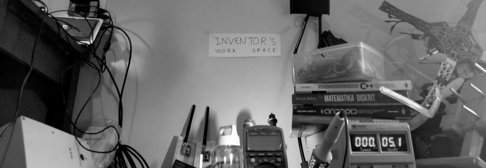

# Royyan Dzakiy

Embedded software engineer. C, modern C++ (17/23), Zephyr RTOS, ESP-IDF.

I work close to the hardware, currently at LMesh IoT on medical and industrial devices, mostly Nordic and Espressif silicon with Zephyr and FreeRTOS. Before that I was AIoT Engineering Manager at eFishery, building fish feeders and leading a team of up to 30 engineers.

Most of my work is in two areas: making firmware testable before the hardware is available, and building toolchains and project structures that other engineers can pick up and run. I am currently extending that into embedded Linux, working with Yocto and the kernel to user-space boundary.

---

## Selected work

- [**dalang**](https://github.com/royyandzakiy/dalang) - a C++23 CLI that starts a new project from a git template in one command: clone, drop the history, rename, fresh git repo. It ships with my own templates for C++, Qt/QML, Zephyr and ESP-IDF, and you can add yours. Named after the puppeteer of Sundanese and Javanese wayang.
- [**zephyr-testing-workshop**](https://github.com/royyandzakiy/zephyr-testing-workshop) - the repo behind my Packt live workshop on automated testing in Zephyr. `native_sim`, `ztest`, Twister driving pytest, and hardware-in-the-loop tests on a self-hosted runner.
- [**zephyr-devcontainer**](https://github.com/royyandzakiy/zephyr-devcontainer) - a Dockerized Zephyr toolchain, so a new machine can build the tree without a day of setup first.
- [**multisensor-station**](https://github.com/royyandzakiy/multisensor-station) - ESP-IDF sensor station in C++20 built for the field: independent sensor modules, data buffered and replayed when connectivity drops, MQTT, OTA updates, and unit, integration and end-to-end tests.
- [**cpp-project-template**](https://github.com/royyandzakiy/cpp-project-template) - the scaffold I start host-side C++ tools from, and dalang's `full` template. CMake presets, vcpkg or Conan behind a toggle, clang-tidy, sanitizers, GitHub Actions.
- [**LoRa-RHMesh**](https://github.com/royyandzakiy/LoRa-RHMesh) - a LoRa mesh routing library for Arduino and PlatformIO, built on RadioHead, with a simulator and tests. My most-starred repo.

Everything else here is smaller experiments.

---

## Teaching and writing

I wrote and run the Packt live workshop *Practical Embedded Automated Testing for Zephyr*, and was technical reviewer for *Developing IoT Projects with ESP32, 2nd Edition*. I also speak at community events. More at [royyandzakiy.com](https://royyandzakiy.com).

---

[LinkedIn](https://www.linkedin.com/in/royyandzakiy/) · [royyandzakiy.com](https://royyandzakiy.com)
